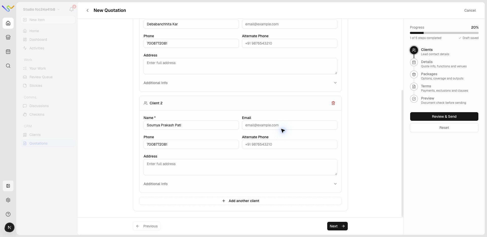
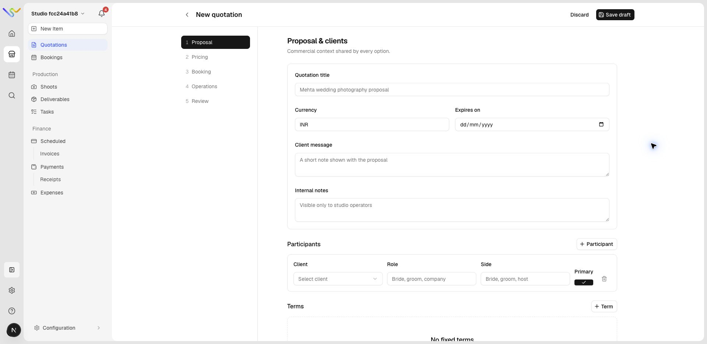
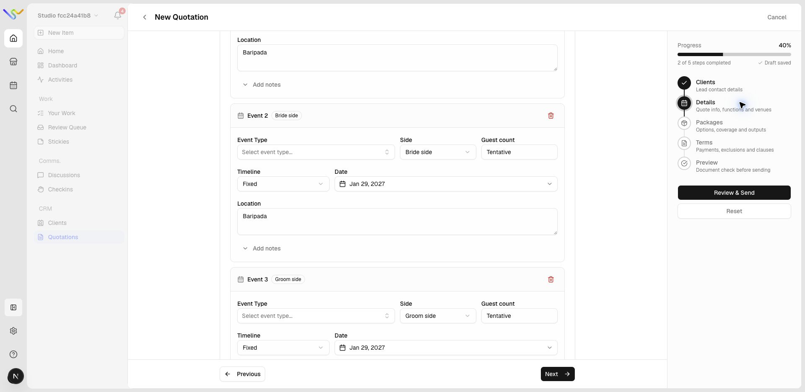
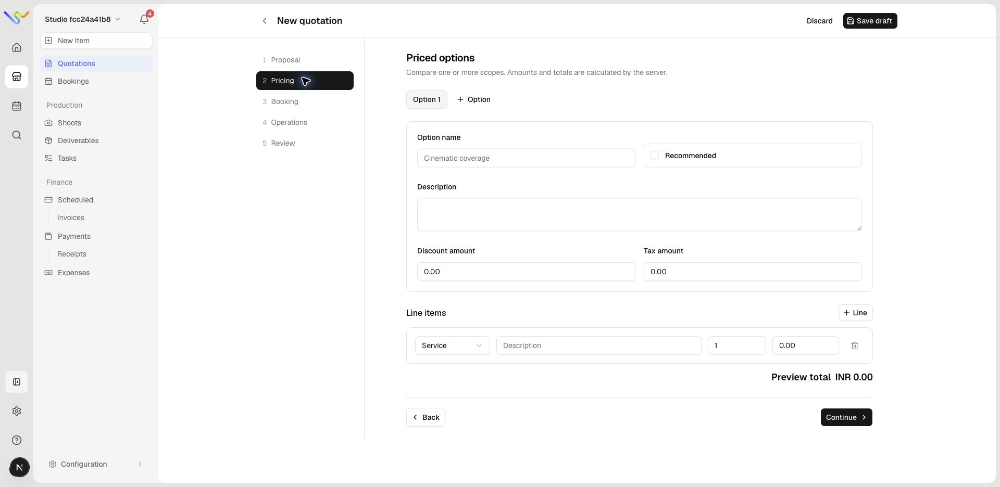
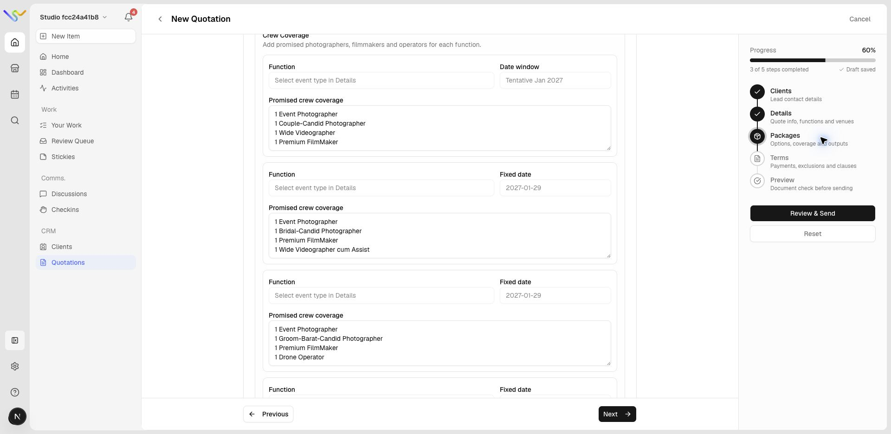
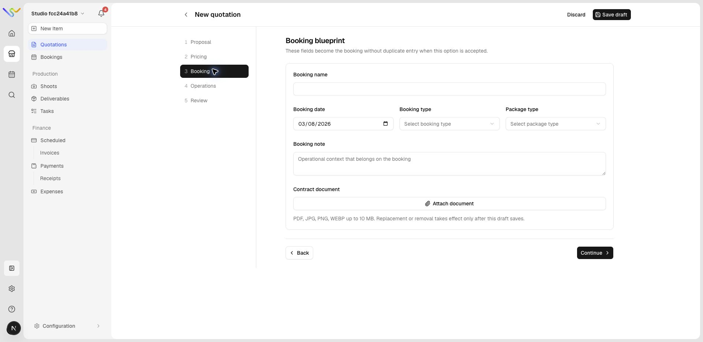
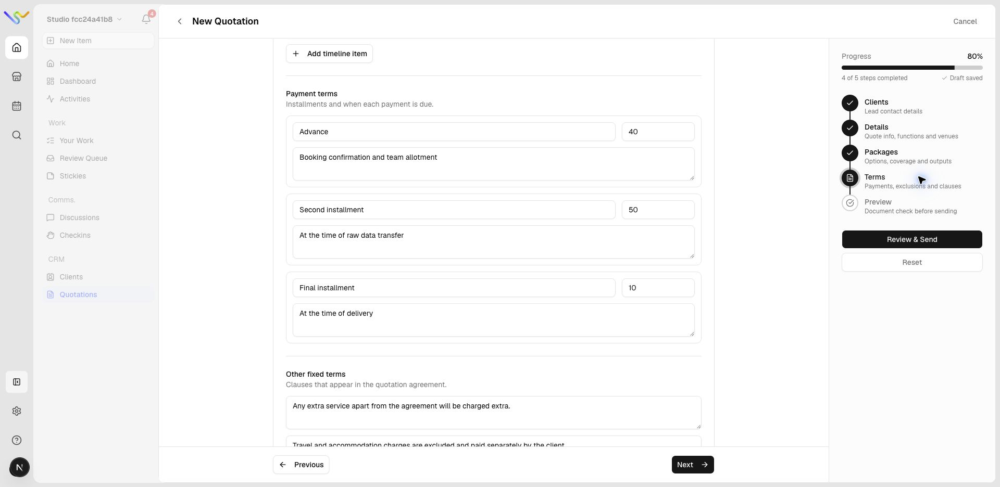
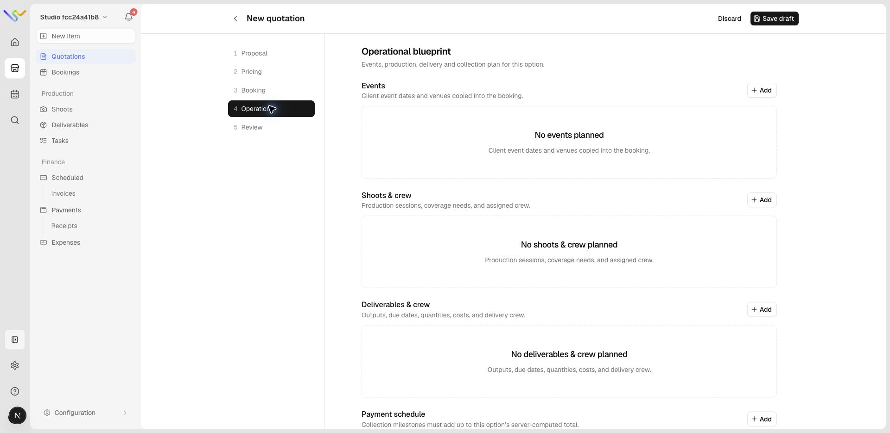
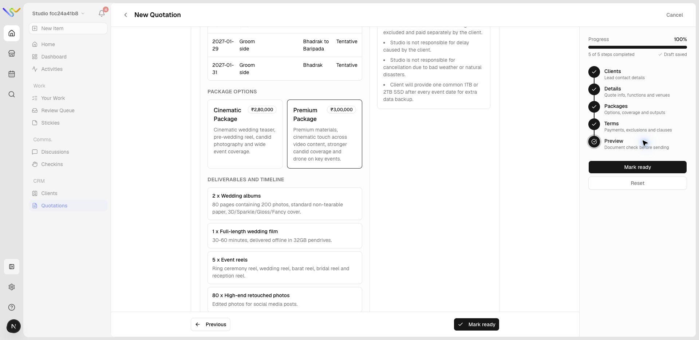
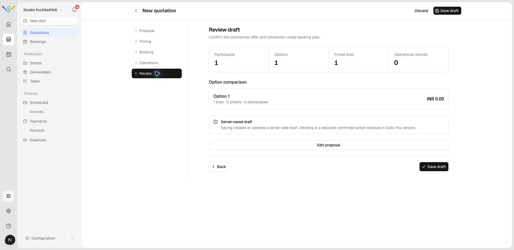

# Quotation UI comparison

Authenticated screenshots captured from the same browser viewport and the same
`localhost:3000` origin. The old frontend branch ran first, followed by the
current quotation implementation, so Better Auth kept working without a second
port.

| Old frontend (`codex/quote-booking-foundation`) | Current implementation (`codex/quotation-system`) |
| --- | --- |
| **1. Clients**  | **1. Proposal**  |
| **2. Details**  | **2. Pricing**  |
| **3. Packages**  | **3. Booking**  |
| **4. Terms**  | **4. Operations**  |
| **5. Preview**  | **5. Review**  |

## Plain-language difference

The old branch is a frontend quotation mock-up focused on collecting client,
event, package, and terms information before previewing a document. The current
version is a working quotation workflow connected to backend data. It separates
the commercial proposal and pricing from what happens after acceptance: booking,
crew/operations, and final review.

The visual structure is related—a five-step editor with a main form and step
navigation—but it is not the same frontend. Labels, information grouping,
navigation, and the surrounding app sidebar have all changed.
