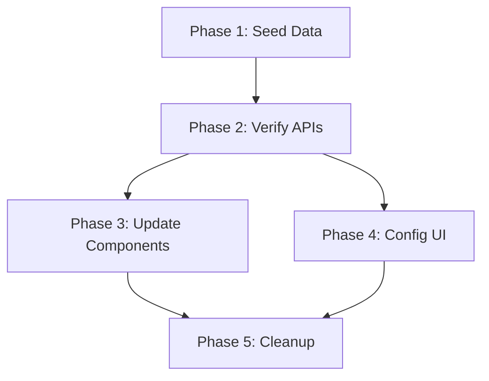

# Plan: Remove Mock Data from Booking Form

## Current State Analysis

### Multi-Page Booking Wizard Structure
The booking form is a 5-step wizard located at:
- **Routes**: `/apps/web/app/(saas)/app/[organizationSlug]/bookings/new/`
  - `details/` - Step 1: Booking details & participants
  - `shoots/` - Step 2: Photo/video shoots with crew
  - `payments/` - Step 3: Payment records & schedules
  - `deliverables/` - Step 4: Deliverables definition
  - `review/` - Step 5: Review & submit

### Components
- `/apps/web/modules/saas/studio/components/bookings/booking-form/`
  - `BookingDetailsStep.tsx` - Uses mock booking types, package types, relation types
  - `BookingShootsStep.tsx` - Uses mock crews and crew roles
  - `BookingPaymentsStep.tsx` - Hardcoded payment methods (acceptable)
  - `BookingDeliverablesStep.tsx` - Uses mock crews for assignments
  - `BookingReviewStep.tsx` - Uses all mock data for display lookups

### Mock Data File
**Location**: `/apps/web/modules/saas/studio/lib/mock-data.ts`

Contains:
| Mock Data | Lines | Real Source |
|-----------|-------|-------------|
| `MOCK_BOOKING_TYPES` | 8-15 | `configurations` table (type: booking_type) |
| `MOCK_PACKAGE_TYPES` | 17-42 | `configurations` table (type: package_type) |
| `MOCK_RELATION_TYPES` | 44-51 | `configurations` table (type: relation_type) |
| `MOCK_CREW_ROLES` | 53-61 | Should derive from crews or configurations |
| `MOCK_CLIENTS` | 63-69 | `clients` table |
| `MOCK_CREWS` | 71-108 | `crews` table |

### Hardcoded Options in Schema
**Location**: `/apps/web/modules/saas/studio/components/bookings/booking-form/booking-form-schema.ts`

| Constant | Lines | Recommendation |
|----------|-------|----------------|
| `SHOOT_TYPE_OPTIONS` | 261-274 | Move to configurations OR keep (domain-specific) |
| `DELIVERABLE_TYPE_OPTIONS` | 279-294 | Move to configurations OR keep (domain-specific) |
| `PAYMENT_METHOD_OPTIONS` | 299-306 | Keep hardcoded (standard payment methods) |
| `PAYMENT_SCHEDULE_PRESETS` | 311-317 | Keep hardcoded (common presets) |

---

## Implementation Plan

### Phase 1: Seed Configuration Data (Backend)

**Goal**: Populate the `configurations` table with real data so APIs return non-empty results.

#### Task 1.1: Create Database Seed Script
Create a seed script for organization-specific configurations.

**File**: `packages/database/src/seed/configurations.ts`

```typescript
// Seed data for configurations table
export const seedConfigurations = [
  // Booking Types
  { type: 'booking_type', key: 'wedding', value: 'Wedding', metadata: { roles: ['bride', 'groom'] } },
  { type: 'booking_type', key: 'portrait', value: 'Portrait Session', metadata: { roles: ['client'] } },
  { type: 'booking_type', key: 'commercial', value: 'Commercial', metadata: { roles: ['client', 'coordinator'] } },
  { type: 'booking_type', key: 'event', value: 'Event Coverage', metadata: { roles: ['client', 'coordinator'] } },
  { type: 'booking_type', key: 'maternity', value: 'Maternity', metadata: { roles: ['client'] } },
  { type: 'booking_type', key: 'newborn', value: 'Newborn', metadata: { roles: ['parent'] } },

  // Package Types
  { type: 'package_type', key: 'basic', value: 'Basic', metadata: { defaultCost: 50000 } },
  { type: 'package_type', key: 'standard', value: 'Standard', metadata: { defaultCost: 100000 } },
  { type: 'package_type', key: 'premium', value: 'Premium', metadata: { defaultCost: 200000 } },
  { type: 'package_type', key: 'luxury', value: 'Luxury', metadata: { defaultCost: 350000 } },

  // Relation Types (Participant Roles)
  { type: 'relation_type', key: 'bride', value: 'Bride' },
  { type: 'relation_type', key: 'groom', value: 'Groom' },
  { type: 'relation_type', key: 'client', value: 'Client' },
  { type: 'relation_type', key: 'family_member', value: 'Family Member' },
  { type: 'relation_type', key: 'event_coordinator', value: 'Event Coordinator' },
  { type: 'relation_type', key: 'parent', value: 'Parent' },

  // Crew Roles (new type)
  { type: 'crew_role', key: 'lead_photographer', value: 'Lead Photographer' },
  { type: 'crew_role', key: 'photographer', value: 'Photographer' },
  { type: 'crew_role', key: 'lead_videographer', value: 'Lead Videographer' },
  { type: 'crew_role', key: 'videographer', value: 'Videographer' },
  { type: 'crew_role', key: 'drone_operator', value: 'Drone Operator' },
  { type: 'crew_role', key: 'assistant', value: 'Assistant' },
  { type: 'crew_role', key: 'editor', value: 'Editor' },
];
```

#### Task 1.2: Add Seed API Endpoint or Migration
Option A: Use existing `configurationsMutations.seed()` endpoint
Option B: Create a database migration with seed data

### Phase 2: Add Missing API Endpoints

#### Task 2.1: Add Crew Roles Configuration API
Extend configurations API to support `crew_role` type.

**Changes needed**:
1. Add `crew_role` to configuration types enum (if not already)
2. Add `crewRolesOptions()` query in `configurationsApi`

#### Task 2.2: Verify All Required APIs Exist
Check that these queries are available and working:
- `configurationsApi.bookingTypesOptions()` ✓ Exists
- `configurationsApi.packageTypesOptions()` ✓ Exists
- `configurationsApi.relationTypesOptions()` ✓ Exists
- `configurationsApi.crewRolesOptions()` - May need to add
- `clientsApi.listOptions()` ✓ Exists
- `crewsApi.listOptions()` ✓ Exists

### Phase 3: Update Frontend Components

#### Task 3.1: Remove Mock Fallbacks from BookingDetailsStep.tsx
**File**: `BookingDetailsStep.tsx` (Lines 57-67)

**Before**:
```typescript
const bookingTypes = bookingTypesData?.data?.length
    ? bookingTypesData.data
    : MOCK_BOOKING_TYPES;
```

**After**:
```typescript
const bookingTypes = bookingTypesData?.data ?? [];
// Show loading/empty state if no data
```

Also:
- Remove imports from mock-data.ts (lines 25-28)
- Add proper loading states
- Add empty state UI when no configurations exist

#### Task 3.2: Remove Mock Fallbacks from BookingShootsStep.tsx
**File**: `BookingShootsStep.tsx`

Changes:
- Remove `MOCK_CREWS` fallback (line 52-53)
- Remove `MOCK_CREW_ROLES` fallback (lines 54-72)
- Add crew roles API query
- Remove hardcoded crew role SelectItems (lines 614-635)
- Add proper loading/empty states

#### Task 3.3: Remove Mock Fallbacks from BookingReviewStep.tsx
**File**: `BookingReviewStep.tsx`

Changes:
- Remove all mock data imports (lines 29-34)
- Remove all fallback logic (lines 69-80)
- Handle missing data gracefully in display

#### Task 3.4: Remove Mock Fallbacks from BookingDeliverablesStep.tsx
**File**: `BookingDeliverablesStep.tsx`

Changes:
- Remove mock crews fallback
- Add proper loading/empty states

### Phase 4: Add Configuration Management UI (Optional Enhancement)

#### Task 4.1: Create Settings Page for Configurations
Allow studio owners to manage their own:
- Booking types
- Package types (with default costs)
- Participant roles
- Crew roles

**Location**: `/app/[organizationSlug]/settings/configurations/`

### Phase 5: Cleanup

#### Task 5.1: Delete Mock Data File
Once all fallbacks are removed:
```bash
rm apps/web/modules/saas/studio/lib/mock-data.ts
```

#### Task 5.2: Update Imports
Search and remove any remaining imports of mock-data.ts

---

## Dependency Order



## Files to Modify

### Backend/Database
1. `packages/database/src/seed/configurations.ts` - NEW: Seed data
2. `packages/api/src/modules/configurations/` - Verify crew_role support

### Frontend (Remove Mock Fallbacks)
1. `apps/web/modules/saas/studio/components/bookings/booking-form/BookingDetailsStep.tsx`
2. `apps/web/modules/saas/studio/components/bookings/booking-form/BookingShootsStep.tsx`
3. `apps/web/modules/saas/studio/components/bookings/booking-form/BookingReviewStep.tsx`
4. `apps/web/modules/saas/studio/components/bookings/booking-form/BookingDeliverablesStep.tsx`

### Delete
1. `apps/web/modules/saas/studio/lib/mock-data.ts`

---

## Risk Assessment

| Risk | Mitigation |
|------|------------|
| Empty dropdowns before seed runs | Add "No options available" UI state |
| Breaking existing bookings | Configuration IDs should match |
| Multi-tenant data isolation | Seed per organization, not globally |

## Testing Checklist

- [ ] Seed configurations for test organization
- [ ] Verify all dropdowns populate from API
- [ ] Create a new booking end-to-end
- [ ] Verify crew assignments work
- [ ] Verify participant roles work
- [ ] Test empty states (new organization with no data)
